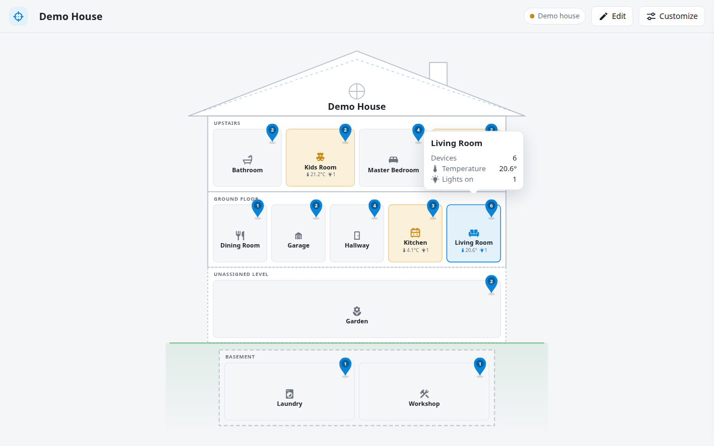
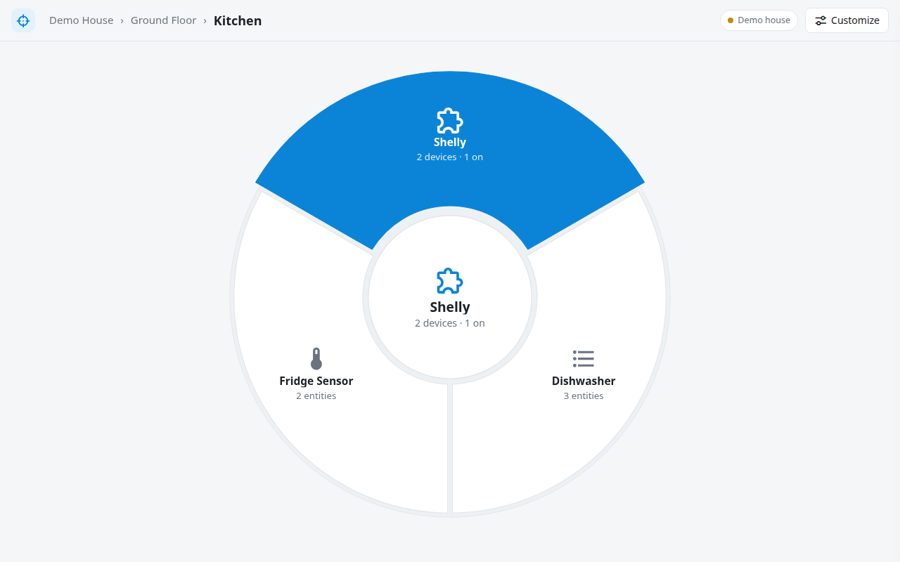
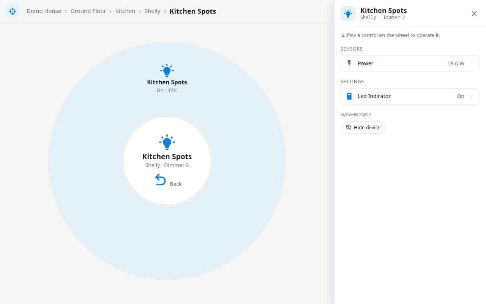
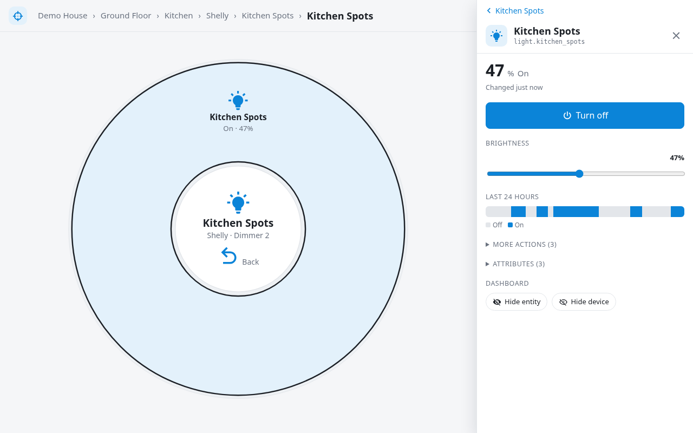
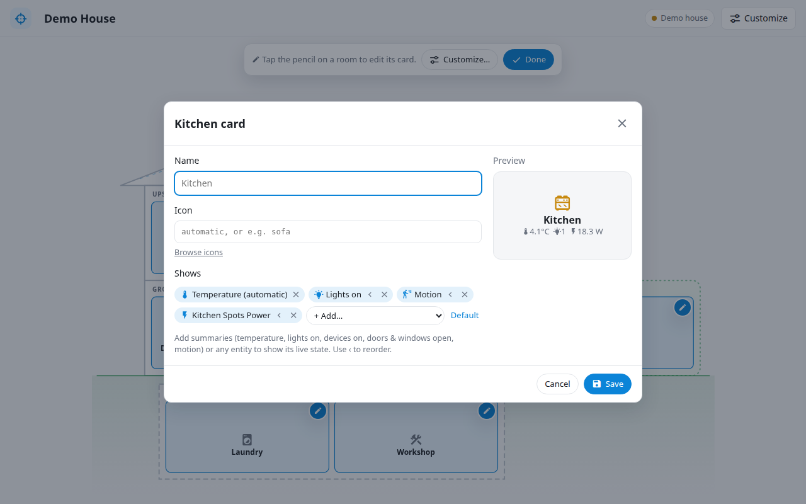
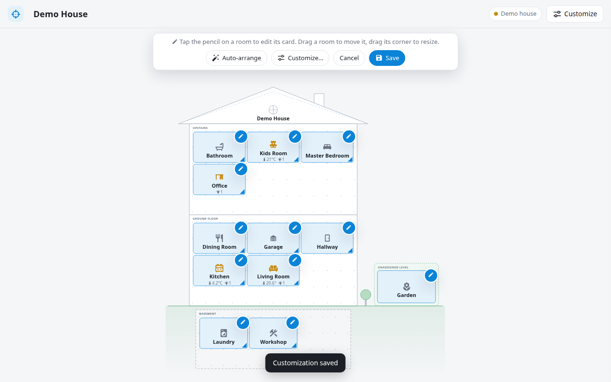
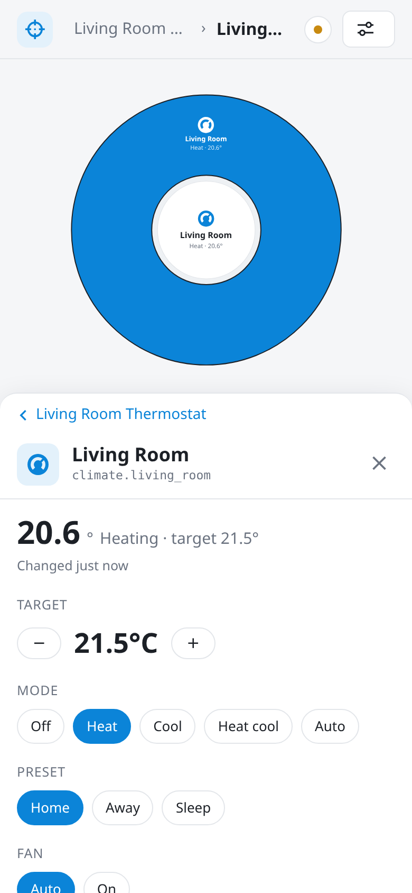

# Weapon Wheel Dashboard for Home Assistant

**Control your home like a video game: a map of your house, weapon-wheel menus for every room, and one-tap actions.**
A Home Assistant app with its own sidebar page. Nothing to configure: it finds your floors, rooms, devices and entities by itself.

[](https://my.home-assistant.io/redirect/supervisor_app/?app=e7dd1b0c_weapon_wheel&repository_url=https%3A%2F%2Fgithub.com%2Fabmina%2Fha-weapon-wheel)

📖 **[User manual](docs/user-manual.md)**: setup, everyday use, room cards, custom homes and troubleshooting.

[](https://github.com/abmina/ha-weapon-wheel/releases)
[](https://github.com/abmina/ha-weapon-wheel/actions/workflows/test.yaml)
[](LICENSE)



## Why

Home Assistant dashboards are lists of cards, and someone has to build them and keep them up to date. This app draws
your home as a house instead. Click a room and its devices open as a weapon wheel, like in a game. Aim, click, and
you're at the controls. New devices show up on their own as soon as you assign them to an area.

## Features

- **House map** - every floor stacked under a roof, basements under the ground line. Each room is a button
  with a map pin showing how many devices it has. Rooms glow when lights are on, and hovering shows the
  temperature, lights on and motion.
- **Device wheel** - click a room: the house zooms away and the room's devices fan open as a weapon wheel. Devices
  of the same integration (all your Shelly or Hue devices in that room, say) share one leaf that opens into its own wheel.
  Point anywhere around it to aim, like a game controller.
- **Entity wheel** - pick a device: the wheel folds shut and opens again with the things you can control on it.
  Its sensors, settings and diagnostics are listed in the sidebar at the same time.
- **Action sidebar** - pick an entity to get the right controls for it:

  | | |
  |---|---|
  | Lights | on/off, brightness, colour temperature, colour, effects |
  | Climate / water heater | target temperature (or heat/cool range), HVAC mode, preset, fan, swing, humidity |
  | Covers / valves | open, stop, close, position, tilt |
  | Media players | play/pause, next/previous, volume, mute, source, sound mode, artwork |
  | Locks / alarm panels | lock, unlock, open; arm home/away/night, disarm, with code |
  | Fans / vacuums / mowers | speed, oscillate, presets, direction; start, pause, dock, locate |
  | Cameras | snapshot, or live video (HLS stream, MJPEG fallback), full screen |
  | Switches, scenes, scripts, buttons, numbers, selects, text, timers, counters, updates | … |

  Plus a **24-hour history** chart, **more actions** from the entity's services, and all its **attributes**.
- **Live** - states update instantly. Changes to areas, devices or floors in Home Assistant appear without a restart.
- **Customize** - name your house, hide, rename or reorder floors, rooms, devices and entities, move a room to
  another floor, or mark a level as **Outdoor** so its rooms show in a garden next to the house.
- **Custom home** - not happy with how your Home Assistant areas map to your real home? Switch to a custom home and
  design your own levels, rooms and groups with any devices or entities, then arrange the rooms on a floor plan.
- **Edit mode** - like a Home Assistant dashboard: tap the pencil on a room card to choose its name, icon and what it
  shows (temperature, lights on, devices on, open doors and windows, motion, or any entity), with a live preview.
  You can also right-click a wheel item to hide it, with undo.
- **Works everywhere** - mouse, keyboard, touch, phones and the Companion app, in light or dark mode
  (it follows your system setting).
- **Locked down** - runs isolated with an AppArmor profile, and the page is only reachable through Home Assistant's
  login (Ingress). It never contacts the internet at runtime.

| Room wheel | Device panel | Controls |
|---|---|---|
|  |  |  |

| Room card editor | Custom home floor plan | Phone |
|---|---|---|
|  |  |  |

## Requirements

Home Assistant **OS or Supervised** (anything with the Apps page). Floors need Home Assistant 2024.4 or newer.
Without floors, all rooms go in a single storey.

The map is built from your **areas**, so assign your devices to areas, and optionally your areas to floors
(*Settings → Areas, labels & zones*).

## Install

1. Click this button - it adds the repository to your Home Assistant (if needed) and opens the app:

   [](https://my.home-assistant.io/redirect/supervisor_app/?app=e7dd1b0c_weapon_wheel&repository_url=https%3A%2F%2Fgithub.com%2Fabmina%2Fha-weapon-wheel)

   Or add it by hand: *Settings → Apps → Install app → ⋮ (top right) → Repositories → Add* and enter
   `https://github.com/abmina/ha-weapon-wheel`, then find **Weapon Wheel Dashboard** in the list.
2. Click **Install**, then **Start**, and turn on *Show in sidebar*.

   > On older Home Assistant versions, apps are called **add-ons**: *Settings → Add-ons → Add-on store →
   > ⋮ → Repositories*.
3. Open **Weapon Wheel** in the sidebar.

The first install builds the app on your Home Assistant machine, which takes a minute or two.

Next, read **[the user manual](docs/user-manual.md)**: how to prepare your areas and floors, use the wheels, edit room
cards and build a custom home. A short version is on the app's **Documentation** tab ([DOCS.md](weapon_wheel/DOCS.md)).

## Controls

| Input | Action |
|---|---|
| Mouse / touch | Aim at a segment, click or tap to select |
| Centre of the wheel | Back |
| Arrow keys | Move between rooms or segments |
| Enter | Select |
| Esc / Backspace | Close the sidebar, then go back a level |
| Scroll wheel / PageUp / PageDown | Next page when a room has more than 10 devices |
| Right-click / long-press a segment | Hide it from the dashboard (with undo) |

## Options

| Option | Default | |
|---|---|---|
| `show_hidden_entities` | off | Include entities hidden in Home Assistant |
| `accent_color` | *(empty)* | Optional hex colour that replaces the theme's blue |

## FAQ

**Does it change anything in Home Assistant?** No. Hiding, renaming and moving rooms only affect this dashboard.
They are saved in the app's own storage and shared by everyone who opens it.

**A device is missing.** It needs an area, either on the device or on its entities. Disabled entities are never
shown, and hidden entities only appear if you turn on the option above. Sensors and diagnostics are not on the wheel:
they are listed in the device's sidebar panel. Also check *Customize* in case it was hidden there.

**Who can use it?** Like every app panel, only Home Assistant administrators see it in the sidebar.

**Something isn't working.** Open an [issue](https://github.com/abmina/ha-weapon-wheel/issues/new/choose) with
the app log.

## Development

Python + aiohttp backend, plain JavaScript frontend with no build step. A demo house is included:

```sh
cd weapon_wheel/app
pip install aiohttp
python -m unittest discover -s tests -v          # model, API and Home Assistant client tests
DEMO=1 DATA_DIR=/tmp/ww python server.py         # fake house, then open http://localhost:8099
HA_URL=http://homeassistant.local:8123 HA_TOKEN=<long-lived token> DATA_DIR=/tmp/ww python server.py   # your real home
```

---

Not affiliated with or endorsed by Home Assistant or the Open Home Foundation.
