# Weapon Wheel Dashboard: user manual

Weapon Wheel Dashboard is a Home Assistant app that shows your home as a house. Tap a room and its devices open in a
weapon wheel, like in a video game. Pick a device to get its controls, and pick a control to operate it.

This manual covers installing the app, preparing Home Assistant, everyday use, and customizing the dashboard. The
screenshots come from the built-in demo house.

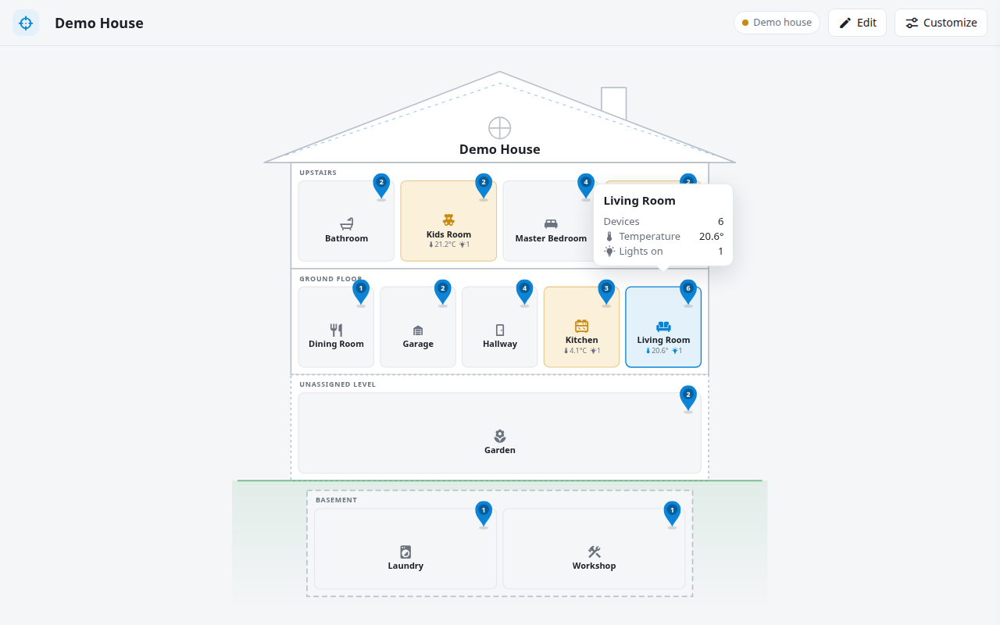

## Contents

1. [Requirements](#1-requirements)
2. [Install the app](#2-install-the-app)
3. [Prepare Home Assistant](#3-prepare-home-assistant)
4. [Open the dashboard](#4-open-the-dashboard)
5. [The house](#5-the-house)
6. [Room wheels and groups](#6-room-wheels-and-groups)
7. [Devices: controls and the device panel](#7-devices-controls-and-the-device-panel)
8. [The entity sidebar](#8-the-entity-sidebar)
9. [Cameras](#9-cameras)
10. [Edit mode and room cards](#10-edit-mode-and-room-cards)
11. [Customize the automatic home](#11-customize-the-automatic-home)
12. [Build a custom home](#12-build-a-custom-home)
13. [App options](#13-app-options)
14. [Keyboard, mouse and touch](#14-keyboard-mouse-and-touch)
15. [Wall panels and other users](#15-wall-panels-and-other-users)
16. [Updates, backups and where settings are kept](#16-updates-backups-and-where-settings-are-kept)
17. [Troubleshooting](#17-troubleshooting)
18. [FAQ](#18-faq)

---

## 1. Requirements

- **Home Assistant OS or Supervised**: an installation with the **Apps** page (*Settings → Apps*). Home Assistant
  Container and Core can't run apps.
- A Home Assistant account. Every user sees the dashboard in the sidebar, but only **administrators** can edit it (see
  [Wall panels and other users](#15-wall-panels-and-other-users)).
- **Floors** (optional) need Home Assistant 2024.4 or newer. Without floors, all rooms go in one storey.

> On older Home Assistant versions, apps are called **add-ons** and live under *Settings → Add-ons*. Everything in this
> manual works the same there.

## 2. Install the app

**With the button (easiest)**

Open the [README](../README.md) on a device that can reach your Home Assistant and click **Open your Home Assistant
instance and show the dashboard of an app**. It adds this repository and opens the app page. Then:

1. Click **Install**. The first install builds the app on your Home Assistant machine, which takes a minute or two.
2. Click **Start**.
3. Turn on **Show in sidebar**.

**By hand**

1. Go to *Settings → Apps → Install app*.
2. Open the **⋮** menu (top right) → **Repositories**.
3. Add `https://github.com/abmina/ha-weapon-wheel` and close the dialog.
4. Find **Weapon Wheel Dashboard** in the list (search for it if needed) and continue with step 1 above.

## 3. Prepare Home Assistant

The **automatic home** is built from what is already in Home Assistant, so a little tidying makes it look right. If
you'd rather not change Home Assistant, skip this section and build a [custom home](#12-build-a-custom-home) instead.

| In Home Assistant | Becomes in the dashboard |
|---|---|
| **Floors**, ordered by their *level* | Storeys of the house. Negative levels are drawn below the ground line. |
| **Areas** | Rooms on their floor. Areas without a floor go in an extra **Unassigned level**. |
| **Devices** in an area | The room's wheel. Two or more devices from the same **integration** are grouped. |
| **Entities** | Controls go on the wheel. Sensors, settings and diagnostics go in the device panel. |
| Home name (*Settings → System → General*) | The name on the roof (you can change it). |

Set this up under *Settings → Areas, labels & zones*:

1. Create your **floors** and give each one a level (`0` for the ground floor, `1` for upstairs, `-1` for the basement).
2. Create an **area** for every room and pick its floor.
3. Give every device an area. Open a device under *Settings → Devices & services → Devices* and set its area.

Changes in Home Assistant show up in the dashboard within a few seconds. You don't need to restart anything.

> **What doesn't appear?** Disabled entities never appear. Entities hidden in Home Assistant only appear if you turn on
> the *Show hidden entities* [option](#13-app-options). Devices and entities without an area are not on the automatic
> home, but you can still use them in a custom home.

## 4. Open the dashboard

Click **Weapon Wheel** in the Home Assistant sidebar. It also works in the Home Assistant **Companion app** on phones
and tablets.

The top bar shows:

- **Breadcrumbs**: where you are, for example *My Home › Ground Floor › Kitchen › Shelly › Kitchen Spots*. Tap any
  step to jump back to it.
- **Connection pill**: *Connected* (green), *Offline* (red) or *Demo house* (amber, when the app runs without Home
  Assistant).
- **Edit**: [edit mode](#10-edit-mode-and-room-cards) for room cards and the floor plan (shown on the house).
- **Customize**: [hide, rename and rearrange](#11-customize-the-automatic-home), or switch to a
  [custom home](#12-build-a-custom-home).

The dashboard follows your device's **light or dark mode** automatically.

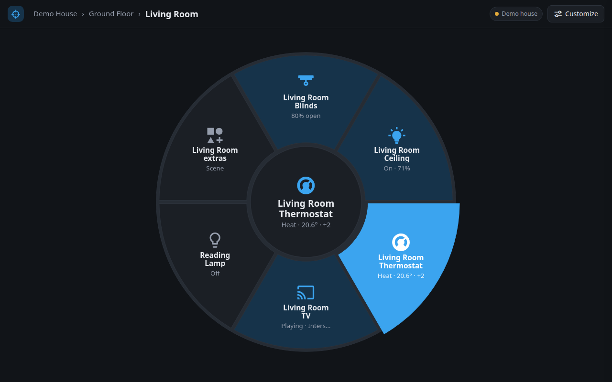

## 5. The house

- Every **storey** is a band in the house, with upstairs at the top. Basements sit under the green ground line.
- Every **room** is a card. A **pin** on the card shows how many items its wheel has: devices, plus groups counted as
  one each.
- The card's **status line** shows live information. By default that's the temperature, the number of lights on, and a
  motion icon when motion is detected. Rooms with lights on glow amber. You choose what each card shows in
  [edit mode](#10-edit-mode-and-room-cards).
- **Hover** over a room (mouse) to see a tooltip with the device count and exactly what the card shows, with names.
- **Click or tap** a room to open its wheel.

**Outdoor rooms.** Rooms on a level marked **Outdoor** are drawn in a fenced garden next to the house. On phones and
other portrait screens the gardens are drawn below the house instead, so the house can use the full width.

**Weather.** The top-left corner shows the current weather: condition, temperature, today's high and low, humidity and
the next few days (phones show just the condition and temperature). Tap it for details and history. By default it uses
Home Assistant's own **Met.no** weather (or the first weather entity it finds). To use another weather integration,
or to hide it, pick one in **Customize → Weather**, or tap the pencil on the weather card in
[edit mode](#10-edit-mode-and-room-cards).

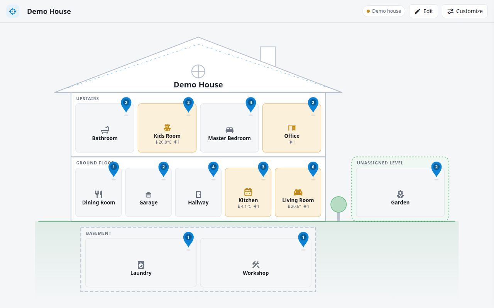

## 6. Room wheels and groups

Opening a room zooms into it and fans its devices out as a wheel.

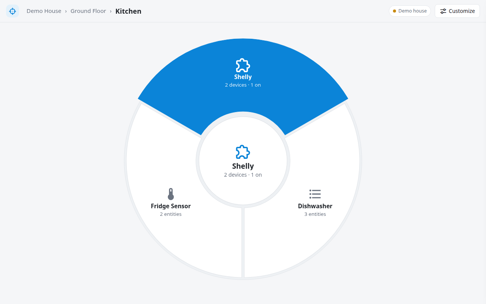

- **Aim**: move the mouse or your finger over the wheel. The slice you point at lights up, and the centre shows its
  name and state. Only the wheel itself reacts; clicking outside it does nothing.
- **Select**: click or tap the slice.
- **Back**: click the centre of the wheel, press **Esc**, or use the breadcrumbs.
- **More than 10 items**: the wheel gets pages. Use the arrows beside it, the scroll wheel, or **PageUp/PageDown**.

**Groups.** When a room has two or more devices from the same integration (for example several Shelly devices), they
share one slice named after the integration, such as *Shelly · 2 devices · 1 on*. Select it to open a wheel with just
those devices. Rooms whose devices all come from one integration aren't grouped, because that would only add a click.
In Customize you can rename a group or turn grouping off. In a custom home you make your own groups instead.

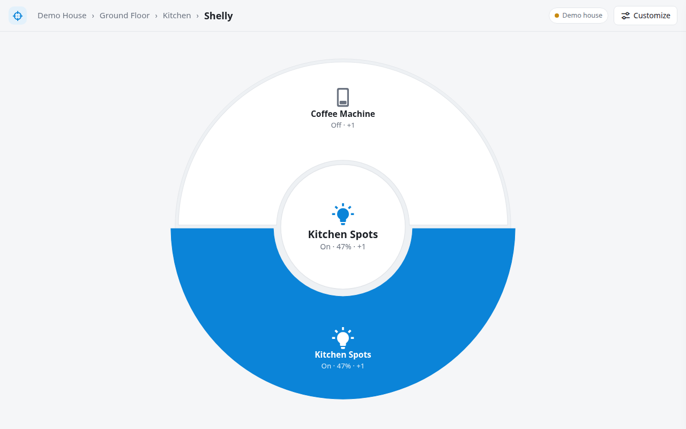

## 7. Devices: controls and the device panel

Selecting a device does two things at once:

- The wheel folds shut and opens again with the device's **controls**: the things you can operate, such as lights,
  switches, fans, covers, climate, media players, locks, cameras, scenes, scripts, buttons, numbers and selects.
- The sidebar opens the **device panel** with everything you read rather than operate:
  - **Sensors**: sensors, binary sensors and other read-only entities, each with its current value.
  - **Settings**: entities Home Assistant marks as configuration (for example an LED indicator or power-on behaviour).
  - **Diagnostics** (folded): battery, signal strength, firmware and so on.

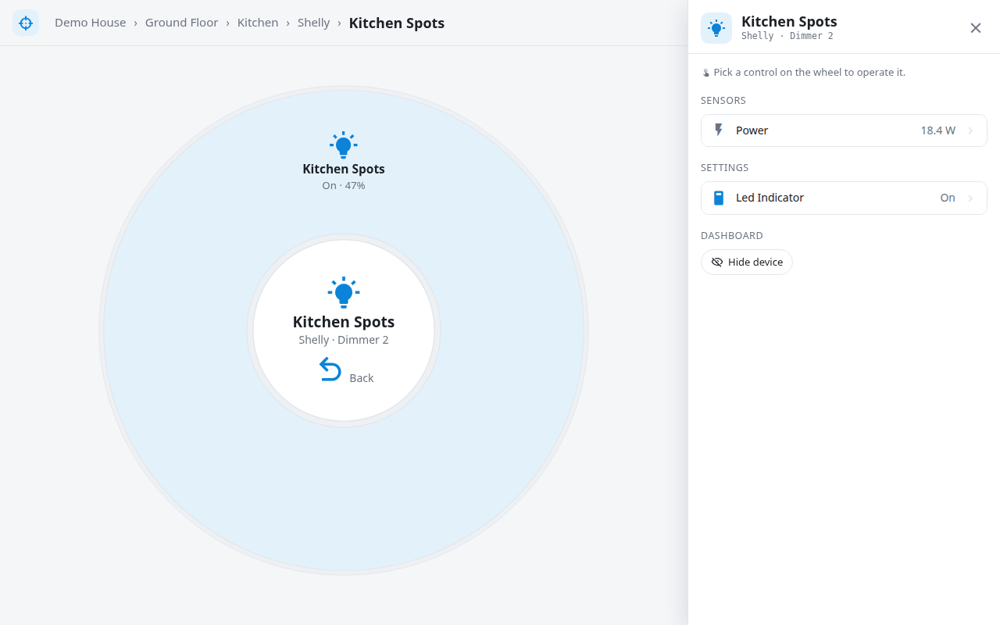

Tap a row in the panel to open that entity. A device with **nothing to operate**, such as a temperature sensor, doesn't
open an empty wheel; its panel opens straight away.

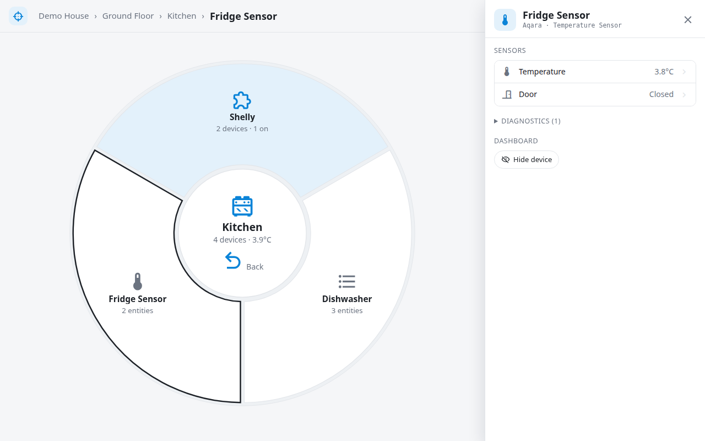

## 8. The entity sidebar

Pick a control on the wheel, or tap a row in the device panel, to open the entity sidebar.

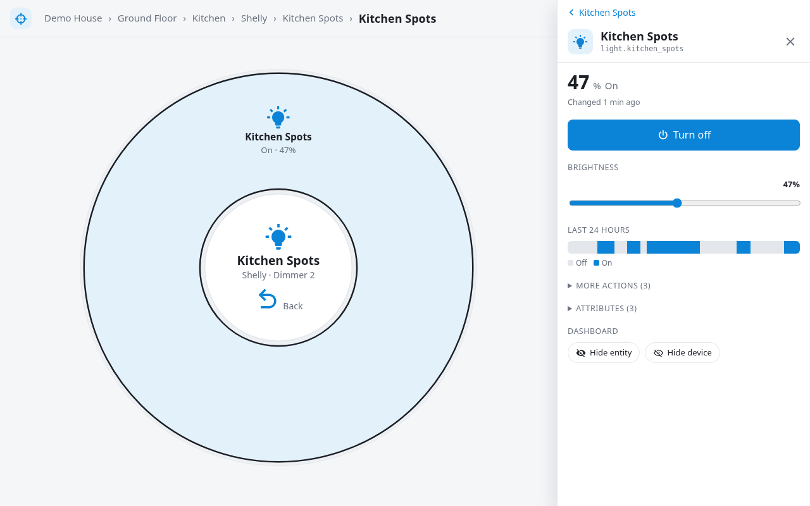

From top to bottom:

- **‹ Device name**: back to the device panel (or press **Esc**).
- **State**: the current value, and when it last changed.
- **Controls** for the entity's type:

  | Type | Controls |
  |---|---|
  | Light | On/off, brightness, colour temperature, colour, effects |
  | Switch, input boolean, siren, remote, automation | On/off (automations also *Run actions now*) |
  | Fan | On/off, speed, oscillate, preset, direction |
  | Cover, valve | Open, stop, close, position, tilt |
  | Climate, water heater, humidifier | Target temperature (or heat/cool range), mode, preset, fan, swing, humidity |
  | Media player | Play/pause, previous/next, volume, mute, source, sound mode, artwork, power |
  | Lock | Lock, unlock, open |
  | Alarm panel | Arm home/away/night, disarm, with a code when needed |
  | Vacuum, lawn mower | Start, pause, stop, dock, locate, suction |
  | Scene, script, button | Activate / run / press |
  | Number, select, text | Slider or box, options, text field |
  | Camera | Snapshot or live video (see [Cameras](#9-cameras)) |
  | Timer, counter, update | Start/pause/cancel, +/−/reset, install |

- **Last 24 hours**: a chart for numbers and a coloured timeline for states such as on/off.
- **More actions**: other actions Home Assistant offers for this entity that need no extra input.
- **Attributes**: every attribute of the entity.
- **Dashboard**: *Hide entity* or *Hide device* removes it from the dashboard (not from Home Assistant). A message
  with **Undo** appears at the bottom.

Controls send their command when you **release** a slider, and the sidebar updates live. If Home Assistant refuses a
command, a red message at the bottom shows why.

## 9. Cameras

A camera's sidebar has a **Snapshot / Live** switch.

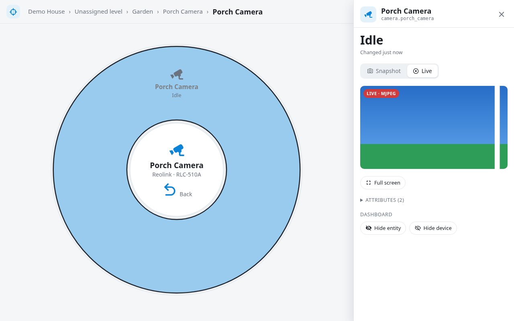

- **Snapshot** shows the latest picture and refreshes it every 10 seconds.
- **Live** plays video:
  - **LIVE · HLS**: smooth video for cameras that support Home Assistant's *stream* integration (part of the default
    configuration).
  - **LIVE · MJPEG**: used for other cameras, and automatically when an HLS stream fails or doesn't start within
    12 seconds.
- **Full screen** shows the picture or video full screen.

The stream stops as soon as you close the sidebar or pick something else. Your Snapshot/Live choice is remembered for
each camera until you reload the page.

## 10. Edit mode and room cards

Click **Edit** on the house to change the dashboard in place, like editing a Home Assistant dashboard.

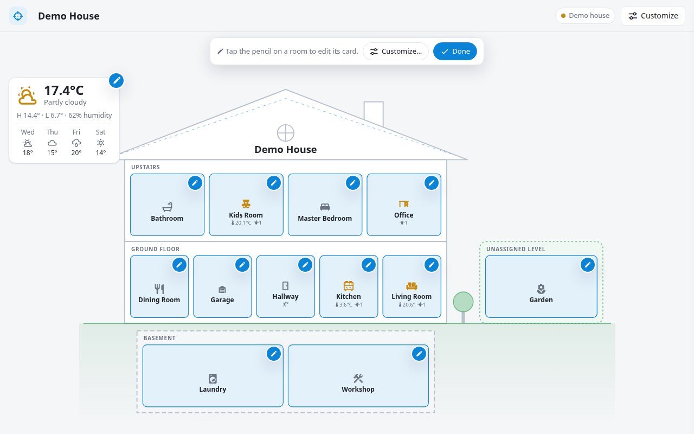

Every room card gets a **pencil**. It opens the **card editor**:

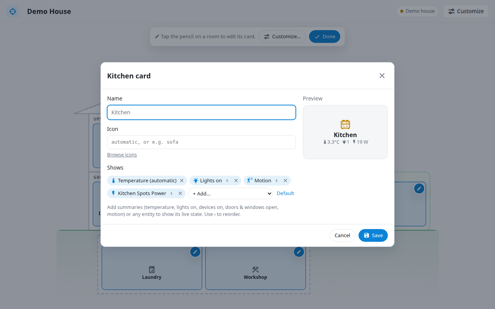

- **Name**: the room's name on the dashboard. Leave it empty to use the Home Assistant name.
- **Icon**: any [Material Design icon](https://pictogrammers.com/library/mdi/). Type its name, for example `sofa` or
  `chef-hat`. Leave it empty for an automatic icon based on the room's name.
- **Shows**: what the card's status line shows, in order. Use **+ Add…** to add:
  - **Summaries**: *Temperature (automatic)*, *Lights on*, *Devices on*, *Doors & windows open*, *Motion*. A summary
    is left out while there's nothing to report (no lights on, no motion and so on).
  - **Any entity** from the room, or any other sensor in the house, to show its live state. For example, pick a
    specific temperature sensor instead of the automatic one, a humidity sensor, or a door.

  Use **‹** to move an item left and **×** to remove it. **Default** goes back to temperature, lights on and motion.
- **Preview** shows the card as it will look.

Click **Save** to apply the card, then **Done** (or **Save** in a custom home) to leave edit mode. **Customize…** in the
edit toolbar opens the Customize window.

The **weather card** also gets a pencil in edit mode: choose any weather entity you have (Met.no, OpenWeatherMap,
AccuWeather and so on), *Automatic*, or *Don't show weather*, with a preview.

In a **custom home**, edit mode is also the [floor-plan editor](#floor-plan).

## 11. Customize the automatic home

Click **Customize** (top right). It opens as a full window; **×** (top right) or **Cancel** closes it. Changes only
take effect when you click **Save**, and they only affect the dashboard, never Home Assistant.

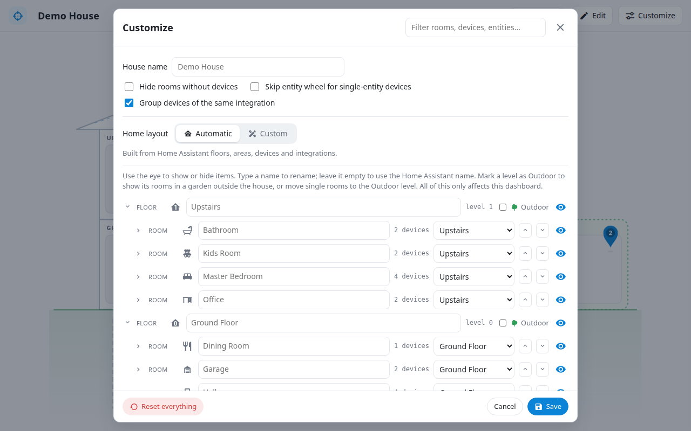

**General settings**

- **House name**: shown on the roof, in the breadcrumbs and in the browser tab. Leave it empty to use the home name
  from Home Assistant.
- **Hide rooms without devices**.
- **Skip entity wheel for single-entity devices**: a device with one control opens it straight away.
- **Group devices of the same integration**: turn integration groups on or off.
- **Weather**: which weather entity the house shows, *Automatic* (Met.no first) or *Don't show weather*.

**The tree**, with levels → rooms → groups → devices → entities, arranged exactly like the wheels:

- **Eye**: show or hide the item on the dashboard.
- **Name field**: rename it for the dashboard. Leave it empty to use the Home Assistant name.
- **Groups**: a room's integration groups appear with their devices inside. Type a new name to rename a group (for
  example *Shelly* → *Kitchen appliances*); leave it empty to use the integration's name. The name is per room.
  Devices you've hidden are listed outside the groups, so you can show them again.
- **Room level list**: move a room to another level, or to the built-in **Outdoor (outside the house)** level.
- **▲ ▼**: reorder rooms on a level.
- **Outdoor** on a level: draw all its rooms in a garden next to the house. This is handy for a *Garden* floor or the
  *Unassigned level*.
- **Search box**: filter the tree by the name of a level, room, group, device or entity, an entity ID, or a device's
  manufacturer or model.

**Reset everything** removes all customizations, including a custom home, when you save.

You can also hide something quickly from a wheel: **right-click** a slice with a mouse, or **long-press** it on Android
(iPhones don't support long-press here; use *Hide* in the sidebar instead). Use **Undo** on the message if needed.

## 12. Build a custom home

If your Home Assistant areas don't match your real home, or you want rooms that mix devices freely, switch to a
**custom home**. You design the levels, rooms and groups yourself, pick any devices or single entities from Home
Assistant (including ones without an area), and arrange the rooms on a floor plan.

### Switching

In **Customize → Home layout**, choose **Custom**. You're asked how to start:

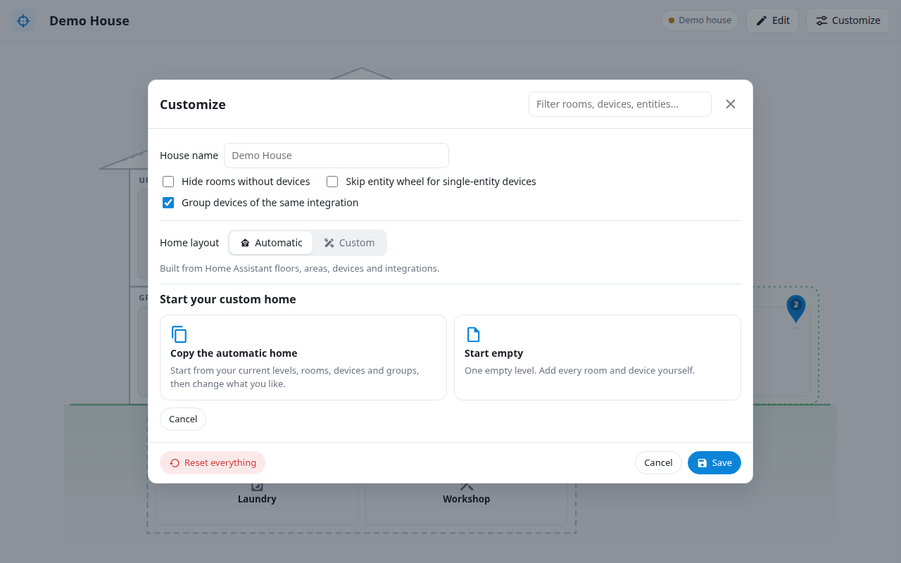

- **Continue my custom home**: shown when you already have one.
- **Copy the automatic home**: starts from your current levels, rooms, devices, groups and room cards.
- **Start empty**: one empty level. You add everything yourself.

Click **Save** to switch. You can go back to **Automatic** at any time, and your custom home is kept for later.

### Levels, rooms and contents

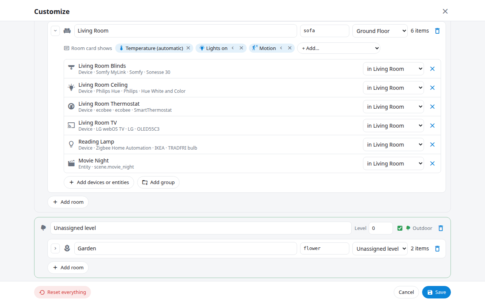

- **Levels** have a name and a **number**. Higher numbers are upstairs and numbers below 0 are underground. Tick
  **Outdoor** to draw a level as a garden. Use **Add level**, or the bin to delete a level and its rooms.
- **Rooms** have a name, an icon (for example `sofa`) and a level. Click **›** to unfold a room. Use **Add room** on a
  level, or the bin to delete a room.
- **Room card shows** sets the room's status line, the same as in the [card editor](#10-edit-mode-and-room-cards).
- **Contents**: each device or entity in the room. Use the lists beside it to put it in a **group** or move it to
  another room, and **×** to remove it.
- **Add devices or entities** opens a picker with two tabs and a search box. Items already in this room are ticked and
  greyed out; items in other rooms show where they are. A **device** brings all its entities (controls on the wheel,
  the rest in the device panel). A **single entity** opens straight away when you select it.

  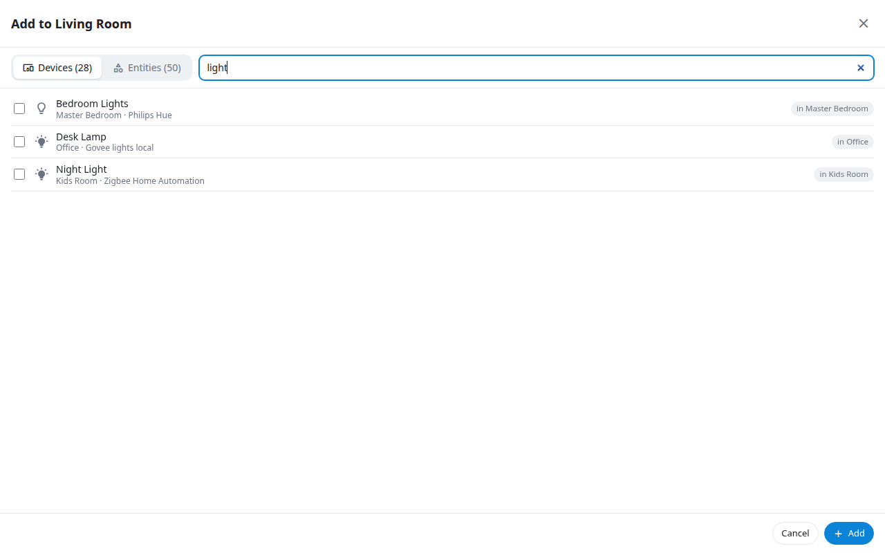

- **Add group** creates a group in the room (name and optional icon). Assign devices to it with the *Group* list.
  Deleting a group keeps its devices in the room.

### Floor plan

After saving your custom home, click **Edit** on the house:

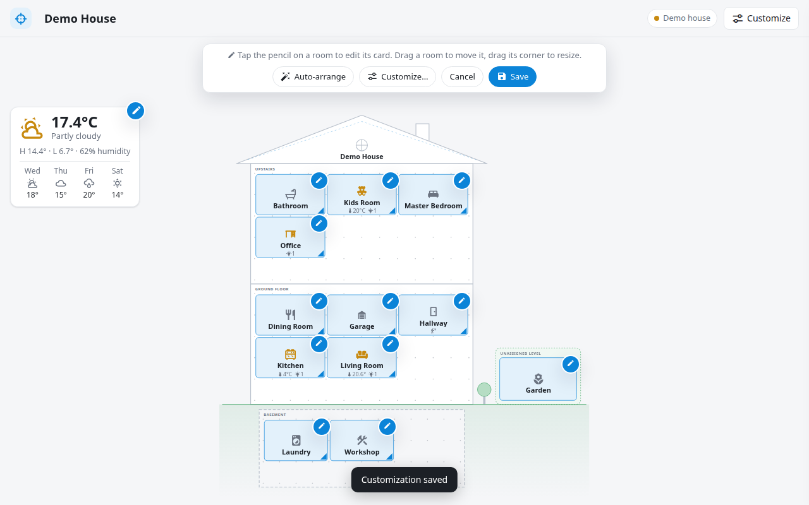

- **Drag a room** to move it. Rooms snap to a grid.
- **Drag the blue corner** of a room to resize it.
- Rooms can't overlap. A move that would overlap is ignored.
- An extra empty row appears under each level while you edit, so you can make a level taller.
- **Auto-arrange** lays every level out again.
- Outdoor gardens arrange themselves.
- **Save** keeps the plan; **Cancel** or **Esc** throws your changes away.

## 13. App options

In *Settings → Apps → Weapon Wheel Dashboard → Configuration*:

| Option | Default | What it does |
|---|---|---|
| **Show hidden entities** | off | Include entities that are hidden in Home Assistant |
| **Highlight colour** | *(empty)* | A hex colour, e.g. `#2e9d57`, that replaces the theme's blue |

Save, then restart the app for options to take effect.

## 14. Keyboard, mouse and touch

| Where | Action | Mouse / touch | Keyboard |
|---|---|---|---|
| House | Pick a room | Click / tap | Arrow keys, then **Enter** |
| Wheel | Aim | Point / drag | Arrow keys |
| Wheel | Select | Click / tap the slice | **Enter** or **Space** |
| Wheel | Back | Click the centre | **Esc** or **Backspace** |
| Wheel | Next/previous page | Scroll wheel, arrows beside the wheel | **PageDown** / **PageUp** |
| Wheel | Hide an item | Right-click / long-press (Android) | |
| Sidebar | Back to the device / close | **‹ Device** / **×** | **Esc** |
| Edit mode | Leave without saving | **Cancel** | **Esc** |

On phones the sidebar slides up from the bottom and the wheel moves up to make room.

| House on a phone | Controls on a phone |
|---|---|
| 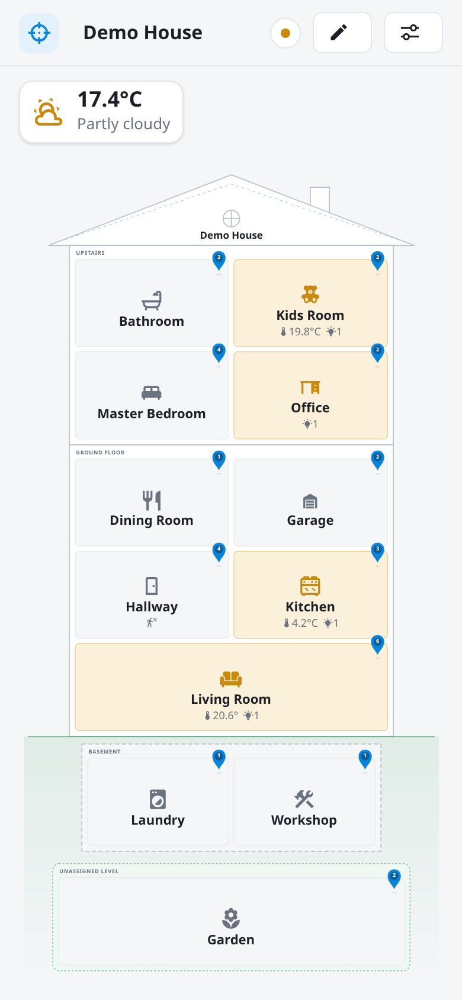 | 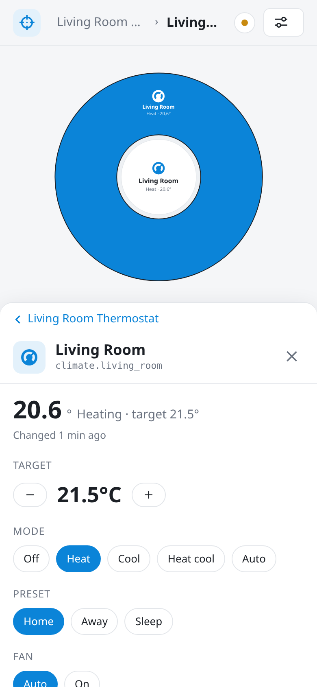 |

## 15. Wall panels and other users

Every Home Assistant user can open the dashboard, including non-administrator accounts such as a wall-panel user.
What they can do depends on their role:

| | Administrators | Other users |
|---|---|---|
| Use the house, wheels, controls and cameras | ✓ | ✓ |
| **Edit** (room cards, weather, floor plan) | ✓ | hidden |
| **Customize** | ✓ | hidden |
| Hide or unhide items (right-click / long-press, *Hide entity*, *Hide device*) | ✓ | hidden |

The app checks this itself: a change sent by a non-administrator is refused, not only hidden on screen. Set up the
dashboard as an administrator; everyone else sees the result.

**Make Weapon Wheel the start page of a wall panel.** The dashboard's address is
`http://<your-home-assistant>:8123/e7dd1b0c_weapon_wheel` (the path shown in the address bar when you open
Weapon Wheel from the sidebar).

- In a **kiosk browser** (for example Fully Kiosk Browser), set that address as the start URL. This is the most
  reliable way.
- In the **Companion app**, log in as the wall-panel user and open Weapon Wheel; the app reopens the last page you
  were on. If your Home Assistant version lists app panels under *Profile → Dashboard*, you can also choose it there.

> Controls on the dashboard work through the app, so a non-administrator can operate every device the dashboard shows.
> Hide anything a wall panel shouldn't control, as an administrator, in Customize.

## 16. Updates, backups and where settings are kept

- **Updates** appear on the app page in Home Assistant. If one doesn't show up, use *Settings → Apps → Install app →
  ⋮ → Check for updates*. The changelog lists what's new.
- **Your customizations** (room cards, hidden items, names, your custom home and floor plan) are stored in the app's
  own storage and shared by everyone who opens the dashboard. They are included in Home Assistant **backups** of the
  app.
- The dashboard **never changes Home Assistant**: hiding, renaming and building a custom home only affect the
  dashboard.

## 17. Troubleshooting

**The dashboard says "Connecting to Home Assistant…" or the pill says *Offline*.**
Open the app's **Log** tab. The app connects through the Supervisor automatically; restarting the app usually fixes a
lost connection.

**A room, device or entity is missing.**
Check that it has an area (automatic home). Check the eye in Customize, and the *Show hidden entities* option.
Disabled entities never appear.

**A control does nothing.**
Look at the red message at the bottom of the screen; it shows Home Assistant's own error. The app log has details.

**The Companion app still shows an old look after an update.**
Close and reopen the dashboard. If it still looks old, reset the app's cache once: in the Companion app's settings
look for **Reset frontend cache** (*Companion App → Debugging* on iPhone, *Companion app → Troubleshooting* on
Android).

**Live camera video shows *LIVE · MJPEG* instead of *HLS*.**
The camera doesn't support Home Assistant's stream integration, or the stream didn't start within 12 seconds. MJPEG
still works; check the camera's integration if you need smooth video.

**The room temperature shows the wrong sensor.**
Open **Edit**, click the room's pencil, remove *Temperature (automatic)* and add the sensor you want under **Shows**.

**A user can't see the Edit or Customize buttons.**
Only Home Assistant administrators can edit the dashboard. Make the user an administrator under *Settings → People*, or
edit with an administrator account.

**Something else.**
Open an [issue](https://github.com/abmina/ha-weapon-wheel/issues/new/choose) with the app log and your Home
Assistant version.

## 18. FAQ

**Does it replace my Home Assistant dashboards?**
No. It's an extra page in the sidebar. Your other dashboards keep working.

**Can several people use it at once?**
Yes. Everyone sees live states, and customizations are shared. Only administrators can change them.

**Does it need the internet?**
No. Everything, including the icons and the video player, is bundled with the app. It talks only to your Home
Assistant.

**Is it secure?**
The page is only reachable through Home Assistant's login (Ingress), the app runs with its own AppArmor security
profile, and direct requests to its port are refused.

**Can I try it without Home Assistant?**
Yes. Developers can run it with a built-in demo house; see *Development* in the [README](../README.md).
